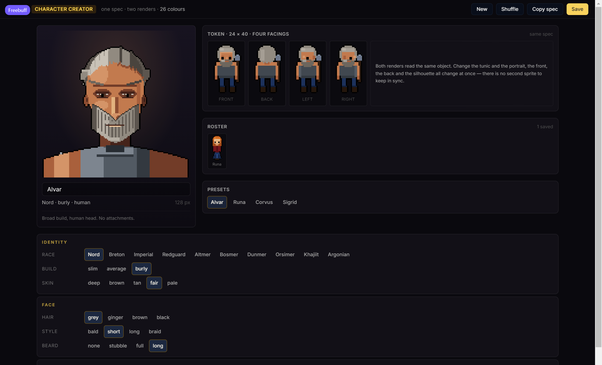
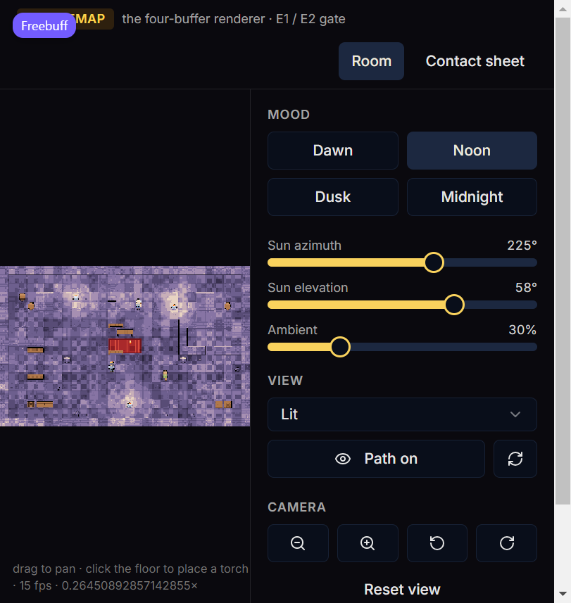

# Checkpoint — 6 November 2026

A status ledger for the procedural art track and the table's first step, written
so the next session starts from what is true rather than what was intended. It
records what runs, what was actually checked, and what is still short of the bar.





---

## 1. What runs

### The board — `/battlemap`

- One `Uint32Array` surface, built once from the room grid; a normal map derived
  from it; a baked static light cache. Each frame copies the cache, re-shades only
  the moving lights' bounds, then runs the dynamic passes in a fixed order.
- 32 px cells. Six material ramps plus ink and void. Floors, walls, seams, per-cell
  variants and a per-room low-frequency wash, so a tile is never its neighbour's
  twin.
- Parametric props — rug, table, bench, chest, crate, barrel, shelf, brazier,
  column, rubble — placed by fractional coordinates and snapped at build.
- Four moods (dawn, noon, dusk, midnight) sharing one palette and one lit-brazier
  rig, plus a debug set: lit, normals, height, specular, materials, and a
  contact sheet.
- Character tokens are rendered from the same spec as the dialogue bust, so a
  token cannot drift from the portrait it belongs to.
- Demo room only. There is no scene importer yet; the room is authored in
  `src/battlemap/room.ts`.

### The character creator — `/characters`

- One `CharacterSpec` drives two renders: a 128 × 128 dialogue bust and a
  24 × 40 board token in four facings. No second sprite exists to keep in sync.
- Ten races with authored attachments at both scales: swept elven ears, an orc's
  brow shelf and tusks, a Khajiit muzzle and slit pupils, an Argonian crest and
  snout on the olive ramp. Argonians have no hair, and the style row says so.
- Every slot is wired to both renders: race, build, skin tone, hair colour, hair
  style, beard, torso, torso cloth, legs, legs cloth, weapon.
- Presets, shuffle, save to a roster, load, delete, and copy-spec. A saved
  character is the spec (about 200 bytes), never a baked sprite.
- The header reports the live colour count; the presets sit under the 32-colour
  budget.

### Table groundwork — `src/net`, `worker/`

- A room code per GM visit, a join link and QR, and a WebRTC data channel between
  the GM's browser and each player's device. The Cloudflare Worker
  (`RoomRelay`, a Durable Object) introduces devices and carries table messages
  when a network will not let them connect directly. It stores nothing.
- **Presence only.** A player announces their character; the GM's table lists who
  is connected and by which path. Live sheets, roll cards, GM edits and combat
  state are not on the wire yet (`docs/TABLE-SYNC-DECISIONS.md`).

### The specs

- [BATTLEMAP-SPEC.md](BATTLEMAP-SPEC.md) — movement, paths, reach, elevation,
  hazards, camera. The grid survives because the book measures in feet.
- [PIXEL-ART-SPEC.md](PIXEL-ART-SPEC.md) — ramps, outlines, the reference pack
  measured rather than guessed. The withdrawn luminance-separation rule is
  recorded as withdrawn.
- [PRESENTATION-SPEC.md](PRESENTATION-SPEC.md) — commit-then-watch, beat sheets,
  hit-stop, impact grammar, per-device camera direction.
- [TABLE-SYNC-DECISIONS.md](TABLE-SYNC-DECISIONS.md) — the GM's decisions, which
  outrank the sync spec where they disagree.
- [COMBAT-SYNC-SPEC.md](COMBAT-SYNC-SPEC.md) — revised for path-based movement,
  the enter-and-leave opportunity attack, forced displacement never provoking,
  and reach authored on the attack row with the band derived.

## 2. What was verified

- `tsc -p tsconfig.app.json --noEmit` — clean.
- `vite build` — clean (one chunk-size warning, unchanged).
- `wrangler deploy --dry-run` — the Worker bundles and both bindings
  (`ROOMS`, `ASSETS`) resolve.
- In a browser: every creator slot changes both renders, presets/shuffle/save/
  load/delete work, race attachments appear at both scales, the board renders all
  four moods and its tokens, and `/battlemap` still renders after the shared body
  renderer changed.

Not verified, and not to be claimed:

- Table presence with a second physical device, and the relay fallback on an
  isolated network.
- Touch input, phone frame timing, or sustained FPS on low-end hardware.
- Any deployment of the Worker. The dry run proves it bundles, not that a room
  works in production.

## 3. Still being perfected

In priority order. The first item is the reason this checkpoint exists.

1. **The face.** The bust resolves landmarks — crown, hairline, brow, eye, nose,
   mouth, chin — but not planes. The eyes are a dark slit with one catchlight, the
   nose a wedge with no bridge, the mouth a line rather than lips, the brow a band
   rather than a ridge, and the cheeks and jaw are filled flat. At 352 px it reads
   as a symbol of a face, not a portrait. The next pass rebuilds the eye/brow/nose/
   mouth cluster and shades the skull (temple, cheekbone, jaw) instead of filling
   it. Everything else waits behind this.
2. **Long hair and braid** read as a bob: the side masses are too short and too
   even, and the braid is a texture rather than a shape.
3. **The token's hands and weapons** are iconic blocks. Correct at board scale,
   not at sheet scale. The 3.5-head proportion is a deliberate choice, not a bug.
4. **The board is not a game yet.** No scene import, no pathfinding or reach-band
   overlay in the UI, and none of the presentation beats (commit-then-watch,
   hit-stop, camera shots) are implemented. They are specified, not built.
5. **Table sync stops at presence.** Sheets, rolls, GM edits and combat state are
   the next steps; none of them are on the wire.
6. **The creator is a lab, not the flow.** It is a standalone page linked beside
   `/battlemap`; the guided character-creation wizard does not open it yet.

## 4. Running it

```bash
bun install
bun run dev          # http://localhost:8080 — /characters, /battlemap
npx wrangler dev     # http://localhost:8787 — the room relay, if testing a table
```

`vite.config.ts` proxies `/api` to 8787 for local table tests. On the hosted site
the relay is same-origin.

## 5. File map

| Path | What it owns |
|---|---|
| `src/battlemap/surface.ts` | packed pixel surface, materials, tags |
| `src/battlemap/palette.ts` | ramps, packing, colour maths |
| `src/battlemap/paint.ts` | floors, walls, seams, wash |
| `src/battlemap/props.ts` | the parametric object library |
| `src/battlemap/light.ts` | static rig, flicker, per-frame shading |
| `src/battlemap/renderer.ts` | build-once frame loop and debug views |
| `src/battlemap/room.ts` | the demo room, lights, moods |
| `src/characters/spec.ts` | the character spec, ramps, presets |
| `src/characters/bust.ts` | the 128 px dialogue portrait |
| `src/characters/body.ts` | the 24 × 40 token, four facings |
| `src/characters/race.ts` | race attachments at both scales |
| `src/characters/roster.ts` | spec-only persistence |
| `src/pages/Characters.tsx` | the creator UI |
| `src/net/table.ts` | host and seat, direct then relayed |
| `src/net/link.ts` | PeerLink and the reconnecting relay socket |
| `worker/index.ts` | `RoomRelay`, the introduction service |

## 6. The standard

The target is a tactics JRPG, not a VTT with nicer tiles. Look is judged at
1:1 and at 3× zoom, on a phone and a laptop. A thing is finished when it reads
without a caption — the board without a legend, the character without a label.
Nothing in this checkpoint meets that bar yet; it is the foundation the bar is
measured against.
